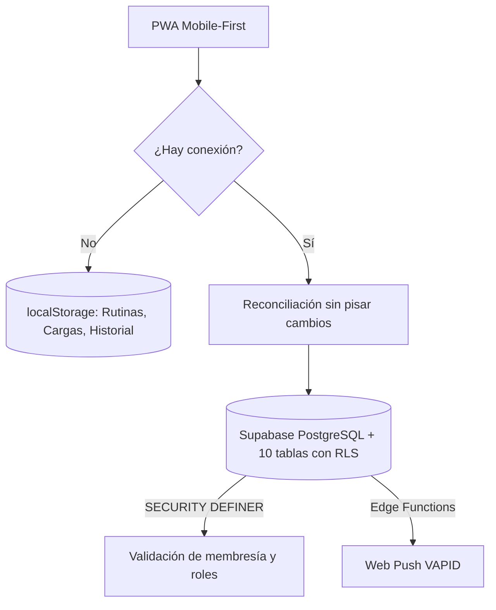

# Gym-Sync — Caso de Estudio (PWA Offline-First para Entrenamientos)

> **Repositorio Showcase (sin código fuente):** Este repositorio documenta la arquitectura, el enfoque *offline-first* y las pruebas realizadas sobre **Gym-Sync**. El código fuente se mantiene privado.

---

## Resumen

- **Tipo:** Aplicación Web Progresiva (PWA) mobile-first
- **Estado:** En producción y uso diario activo por **5 usuarios reales**
- **Mi rol:** Ideación, definición de reglas de negocio, dirección del desarrollo asistido por IA, pruebas funcionales en uso real y despliegue
- **Stack utilizado:** React, Vite, Tailwind CSS, Service Worker, Supabase (Auth, PostgreSQL, RLS, Edge Functions), Web Push (VAPID), Vercel

---

## El problema a resolver

En salas de gimnasio y subsuelos la señal móvil suele ser mala o intermitente. Muchas apps de entrenamiento fallan o bloquean al usuario si pierden conexión en medio de una serie, o pisan datos al reconectar cuando un grupo comparte rutinas o sedes.

---

## Solución construida

**Gym-Sync** prioriza la experiencia móvil en el gimnasio:

1. **Funcionamiento 100% Offline-First:**
   - Persistencia inmediata en `localStorage` para rutinas, ejercicios, series completadas y cargas usadas por cada persona.
   - Detección de conectividad (`online` / `offline`) sin bloquear acciones del usuario durante el entrenamiento.
   - Reconciliación automática al recuperar señal, conservando registros creados offline sin sobrescribir cambios remotos de otros integrantes del grupo.

2. **Gestión grupal y rutinas compartidas:**
   - Creación de grupos de entrenamiento, sedes y catálogos compartidos con flujo de solicitudes/aprobaciones.
   - Historial de cargas por usuario con selección múltiple, eliminación masiva y prevención automática de ejercicios duplicados en una misma fecha.
   - Interfaz mobile-first (áreas táctiles de al menos 44px), carga diferida (`React.lazy`), modo oscuro y notificaciones push (VAPID).

---

## Seguridad y validación en uso real

- **Row Level Security (RLS) en producción:** Migraciones SQL en PostgreSQL activando RLS en las 10 tablas principales, utilizando funciones auxiliares `SECURITY DEFINER` para verificar membresía y permisos de creador sin recursión infinita.
- **Pruebas en condiciones reales:** Iteración continua a partir de bugs reales detectados por los 5 usuarios (reinicio diario en horario de Buenos Aires/CABA, recargas en mitad del entrenamiento, duplicación en historial y uso sin internet).

---

## Arquitectura Offline-First y Seguridad

---

## Contacto

- **Email laboral:** `joaquindiazstefani00@gmail.com`
- **LinkedIn:** [Joaquín Díaz Stefani](https://www.linkedin.com/in/joaquindiazstefani)
